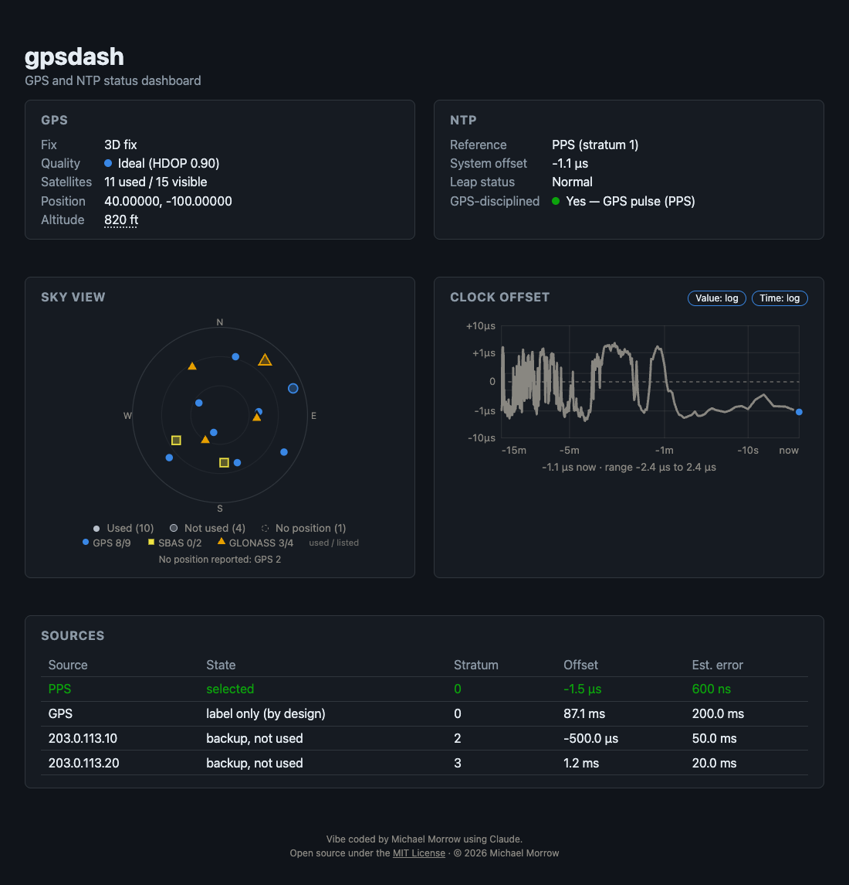

# gpsdash

A small, self-hosted status dashboard for a **GPS-disciplined NTP server**: a machine that runs [chrony](https://chrony-project.org/) and [gpsd](https://gpsd.io/) with a GPS receiver. It shows the GPS fix, the satellites, the clock's offset from GPS time over the last 15 minutes, and chrony's time sources, on one live page.

**Self-hosted means you run it yourself, on your own hardware.** There is no hosted version, no account and no sign-up, and nothing is sent anywhere: the dashboard talks only to the agent you point it at.



*The screenshot uses demo data; the position shown is made up.*

> **Security note: there is no login.** The agent and the dashboard show the receiver's exact position (latitude, longitude and altitude) to anyone who can reach them. Keep them on a private network, or put a reverse proxy with authentication in front of the dashboard. Do not expose the agent (port 8081) to the internet.

## How it works

Two pieces:

- **Agent** (`agent/`): a small Python HTTP service that runs on the machine with the GPS receiver and exposes chrony's tracking and sources and gpsd's fix data as JSON.
- **Dashboard** (this folder): an Express app that polls the agent and serves the live status page. It can run on the same machine or on another one.

## Requirements

- A machine with a GPS receiver, **chrony** and **gpsd** already working (the dashboard only reads from them; it does not set them up). The agent's user must be able to run `chronyc tracking` and `chronyc sources` and to reach gpsd on `localhost:2947`.
- **Agent:** Python 3 with the `gps` module (Debian and Ubuntu: `sudo apt install python3-gps`). Tested with Python 3.11.
- **Dashboard:** Node.js, the current LTS (tested with Node 24).

### An example setup

The author runs it on a Raspberry Pi 4 with an Uputronics GPS/RTC Expansion Board (a u-blox M8 receiver on the UART at 115200 baud) and the board's once-per-second pulse on GPIO 18 (`pps-gpio`). chrony takes the second from the serial data and the exact edge from the pulse, so it reports stratum 1 with the clock within a few microseconds of GPS time:

```
refclock SHM 0 refid GPS precision 1e-1 offset 0.0 delay 0.2 noselect
refclock PPS /dev/pps0 refid PPS lock GPS precision 1e-7 prefer
```

gpsdash works with any chrony and gpsd setup, with or without the pulse; without PPS the clock is only as good as the serial time.

**Hardware I use**

- Raspberry Pi 4
- Uputronics GPS/RTC Expansion Board (a Raspberry Pi HAT)
- Uputronics Active GPS Patch Antenna (SMA connector, magnetic mount)
- Argon ONE case. It works, but mounting the GPS board in it is awkward. Any case that leaves room for a HAT on the GPIO header should be easier.

This is only what the author happens to have; none of it is required, and nothing here is an endorsement or a sales link.

## Quick start

On the machine with the receiver (the agent):

```bash
cd agent
python3 server.py        # listens on port 8081
```

On the machine that will show the dashboard:

```bash
npm install
AGENT_URL=http://<agent-host>:8081/status npm start
```

Then open `http://localhost:3000`. If the agent runs on the same machine, you do not need `AGENT_URL` (the default is `http://localhost:8081/status`).

## What the page shows

- **GPS**: fix type, satellites used/visible, position, altitude (feet by default; click the value to switch to meters, the choice is remembered in the browser), and a **Quality** line from HDOP (lower is better) with the usual six titles: Ideal (under 1, blue dot), Excellent (under 2) and Good (under 5) in green, Moderate (under 10) yellow, Fair (under 20) orange, Poor red.
- **NTP**: the reference chrony is using, system offset, leap status and a **GPS-disciplined** light. It is on when either the `PPS` or the `GPS` source is the one chrony has selected, and says which. Offsets and errors are shown in the unit that fits their size (ns, µs or ms), so a clock disciplined by a GPS pulse does not read "0.0 ms".
- **Sky view**: every satellite gpsd reports, one shape per constellation (GPS, SBAS, GLONASS, …) in the constellation's colour; solid = used in the fix, translucent = not used, dashed ring = no signal. Satellites below the horizon or without a position are counted in the legend but not plotted.
- **Clock offset**: the last 15 minutes of offset, with `Value` and `Time` toggles (log or linear; defaults log value, log time; remembered per browser). Both value axes are symmetric around zero and zoom to the data, so a PPS-disciplined clock (offsets of a few µs or less) stays readable in either mode: the log axis steps by decades (never tighter than ±1 µs, with a faint line at ±100 ns), the linear axis by 1-2-5 steps (never tighter than ±100 ns), with ticks at 0, ±half and ±the limit. A caption under the graph gives the latest offset and the 15-minute range, each in the unit that fits its size. Yellow marks time with no data (see below).
- **Sources**: chrony's sources, `PPS` first, then `GPS`, then the network servers in chrony's order (the sort is display-only). chrony's states are worded in plain English (selected, blended in, backup, not used, rejected, too jittery, unusable) with a hover explanation. With a PPS setup, `GPS` reads "label only (by design)": it is `noselect` and only tells PPS which second each pulse belongs to. A network server shows its reverse-DNS name when the dashboard server finds one (looked up in the background, cached for an hour, misses for ten minutes, plain hostname characters only); the IP address is in the hover text and is the fallback. The table's numbers update in place so a hover tooltip survives the redraws.

## Configuration

The dashboard server reads these environment variables (all optional):

| Variable | Default | Meaning |
|---|---|---|
| `PORT` | `3000` | Port to listen on. |
| `AGENT_URL` | `http://localhost:8081/status` | The agent's status URL. |
| `AGENT_HISTORY_URL` | `AGENT_URL` with `/status` replaced by `/history` | Where the agent serves its clock-offset history. |
| `POLL_INTERVAL_MS` | `2000` | How often the server polls the agent. It is the only thing that talks to the agent: `/api/status` serves the cached poll. |
| `HISTORY_WINDOW_MS` | `900000` (15 min) | Size of the server's in-memory copy of the history (window / interval samples). |
| `HISTORY_REPROBE_MS` | `300000` (5 min) | After an agent answered 404 for `/history` (an older agent), how often to ask again. |
| `RDNS_OVERRIDE` | unset | JSON `{"ip": "name"}` used instead of reverse DNS for the Sources table. For tests. |

The agent (`agent/server.py`) reads:

| Variable | Default | Meaning |
|---|---|---|
| `AGENT_PORT` | `8081` | Port to listen on (all interfaces). |
| `SAMPLE_INTERVAL_S` | `2` | How often it reads the clock offset from chrony. |
| `HISTORY_WINDOW_S` | `900` (15 min) | How much history it keeps (window / interval samples). |
| `AGENT_HISTORY_FILE` | `~/.local/state/gpsdash-agent/history.json` | Where the buffer is saved. `""` or `off` disables saving. Keep it outside the folder you deploy the agent into, in case a deploy replaces that folder. |
| `HISTORY_SAVE_INTERVAL_S` | `30` | How often the buffer is saved (it is also saved when the agent is stopped). |

If the dashboard cannot reach the agent by a `.local` (mDNS) name, set `AGENT_URL` to the agent's IP address: Node can resolve such names to IPv6 first and then fail.

### Offset history

The **agent owns the history**. It samples chrony every 2 seconds, keeps the last 15 minutes in a ring buffer, saves it to its own disk (every 30 seconds and on SIGTERM) and reloads it at start. So a restart of the agent, of the dashboard, or of both never leaves the graph empty: the graph always starts with the last 15 minutes. Samples that were taken before a restart are restored however old they are, so the time the agent was down shows up as a gap.

The **dashboard server is a relay**. Every poll it fetches the agent's status (for the panels) and the history it has not seen yet (`GET /history?since=<seq>&epoch=<epoch>` on the agent; samples carry ages, so the two machines' clocks are never mixed) and keeps a copy **in memory only**; nothing time-based is written to disk on the dashboard machine. A restarted dashboard refills from the agent on its first poll, with no gap. The copy also lets a page opened while the agent is unreachable still draw the past. Against an older agent that has no `/history`, the server falls back to sampling the status itself, and asks again every few minutes.

`GET /api/history` shows what the dashboard server holds; `GET /api/status?since=<seq>&epoch=<epoch>` returns the status plus the samples newer than `seq` (the page uses this to fetch only what is new).

**Yellow means no data was arriving from the agent.** A stretch of 10 seconds or more with no sample is bridged by a solid yellow line, and while the newest sample is more than 10 seconds old (the agent has gone quiet) the last known value is held out to the right edge in yellow, with a note saying for how long. When data resumes the held line becomes a bridge over the gap, and the note reads "Yellow: no data for ...". A page opened while the agent is unreachable still draws the graph: the server's error reply carries the history. A gap the dashboard itself caused (it was restarted) is filled from the agent, so it is not yellow.

## Running as a service

Two example [systemd](https://systemd.io/) units are in `examples/systemd/`. They run as a dedicated `gpsdash` user and are hardened (no new privileges, read-only file system except the agent's state folder, restricted network families). Adjust the paths and user to your setup. For example:

```bash
# The agent, on the machine with the receiver
sudo useradd --system --home-dir /opt/gpsdash-agent gpsdash
sudo mkdir -p /opt/gpsdash-agent && sudo cp agent/server.py /opt/gpsdash-agent/
sudo cp examples/systemd/gpsdash-agent.service /etc/systemd/system/
sudo systemctl daemon-reload && sudo systemctl enable --now gpsdash-agent

# The dashboard, on the machine that will serve the page
sudo mkdir -p /opt/gpsdash && sudo cp -r server.js package.json package-lock.json LICENSE public /opt/gpsdash/
(cd /opt/gpsdash && sudo npm ci --omit=dev)
sudo cp examples/systemd/gpsdash.service /etc/systemd/system/
sudo systemctl daemon-reload && sudo systemctl enable --now gpsdash
```

(If the user already exists, the `useradd` line fails harmlessly. Edit `AGENT_URL` in the dashboard unit if the agent is on another machine.)

## Development and tests

```bash
npm install
npm start          # http://localhost:3000
```

Tests use [Playwright](https://playwright.dev/) and run against a locally started server, a fake agent, and the real `agent/server.py` with a stub `chronyc` and `gps` module (they need `python3`):

```bash
npm ci
npx playwright install --with-deps chromium
npm test
```

A GitHub Actions workflow (`.github/workflows/test.yml`) runs the same on every push and pull request.

## Project layout

```
server.js              — Express app (dashboard server, relays the agent)
public/
  index.html            — Dashboard UI shell
  style.css
  dashboard.js          — Frontend polling/render logic
agent/
  server.py             — chrony + gpsd JSON exporter
examples/systemd/       — Example systemd units for the dashboard and the agent
tests/
  dashboard.spec.js     — Playwright end-to-end tests
```

## License

[MIT](LICENSE), (c) 2026 Michael Morrow. The page footer says so and links to the license text, which the dashboard serves at `/LICENSE`.

Vibe coded by Michael Morrow using Claude.

This is a personal project shared as is. There is no support, and issues and pull requests are not monitored.
